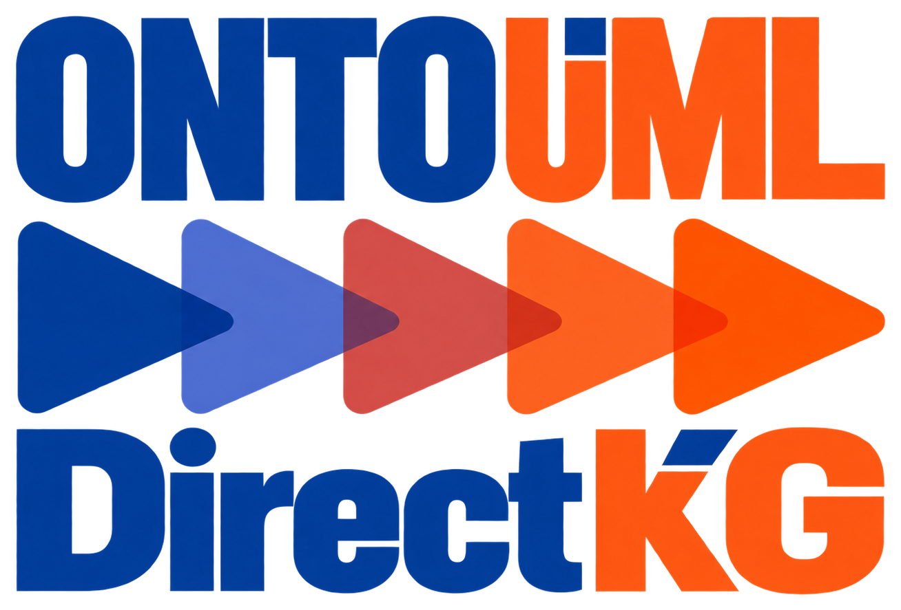

# OntoUML DirectKG

[](LICENSE)
[](documentation/site/getting-started.md)
[](https://github.com/pedropaulofb/ontouml-directkg/commits/main)

<p align="center"></p>

**OntoUML DirectKG** is an open-source project to transform [OntoUML](https://ontouml.org/) conceptual models into **domain-oriented RDF/OWL ontologies**. The intended output describes the modeled domain—its classes, properties, and selected logical constraints—rather than reproducing the OntoUML metamodel, diagrams, or JSON export structure.

It is intended for OntoUML modelers, ontology engineers, knowledge-graph developers, and contributors implementing the transformation.

> **Current status: development implementation.** The repository provides a source-installable Python library and CLI, version `0.0.0.dev1`, alongside the accepted specification, mereology vocabulary and development tests. A bounded conversion is verified in [Getting started](documentation/site/getting-started.md). This does not establish complete transformation conformance or a published package release; unresolved implementation and test-binding limits remain.

## Intended transformation

| Aspect | Specified behavior |
| --- | --- |
| **Input** | OntoUML JSON exported by the Visual Paradigm [`ontouml-vp-plugin` 0.5.3](https://github.com/OntoUML/ontouml-vp-plugin/releases/tag/0.5.3), with bounded support for localized text. Other exporter versions are not guaranteed. |
| **Output** | Domain-oriented RDF/OWL ontology; **RDF 1.1 Turtle** is the sole officially specified ontology serialization. |
| **Interfaces** | A development Python library and CLI are available. Equivalent transformation behavior is the accepted contract; complete interface conformance has not been verified. |

The [normative specification](documentation/specification/transformation-specification.md) defines mappings for:

- **Domain structure:** classes, generalizations, attributes, datatypes, binary relations, and applicable cardinality or generalization-set constraints.
- **Selected OntoUML semantics:** higher-order classification, enumerations, named inverse properties, and controlled material-relation property chains.
- **Mereology:** source-specific properties linked to generic `memberOf`, `subCollectionOf`, `subQuantityOf`, and `componentOf` properties in a reusable DirectKG vocabulary.
- **Identity and reporting:** generated IRIs, multilingual labels, configurable input-handling policies, diagnostics, outcomes, and provenance.

The design intentionally **does not perform general OntoUML semantic validation** or guarantee a particular OWL profile. It does not require gUFO or OntoUML-metamodel imports. Diagram layout, package organization, and custom `propertyAssignments` are outside the domain-graph output scope.

## Explore the repository

| Resource | What it provides |
| --- | --- |
| [Current specification](documentation/specification/transformation-specification.md) | Authoritative requirements for mappings, controls, and intended behavior. |
| [Mereology vocabulary](vocabulary/latest/dkgm-vocabulary.ttl) | Current Turtle representation of the four generic mereological properties and their accepted generic chains; archived releases and PyLODE documentation are maintained under [`vocabulary/`](vocabulary/README.md). **Not** conversion output. |
| [Tests](tests/README.md) and [coverage inventory](tests/coverage.md) | Executable development tests, fixtures, traceability, and partial production-interface bindings. |
| [Open design issues](documentation/specification/open-design-issues.md) | Non-normative, incomplete record of unresolved questions. |
| [Documentation structure](documentation/specification/documentation-structure.md) | Approved page organization and responsibilities; public website sources are under `documentation/site/`. |

## Getting started with the current repository

Use Python **3.12 or later**, as declared in `pyproject.toml`, in a virtual environment. The source installation and example were verified with Python **3.12.14** against `25bf7b2259331d0c439fe0f79f826bae0218b8f7`:

```bash
git clone https://github.com/pedropaulofb/ontouml-directkg.git
cd ontouml-directkg
python -m pip install .
ontouml-directkg --version
```

Follow [Getting started](documentation/site/getting-started.md) for a complete conversion, [Python integration](documentation/site/guides/python.md) for a verified library example, and the [generated API reference](documentation/site/reference/api/index.md) for actual public signatures and result operations. Source installation does not establish availability on PyPI.

The [test instructions](tests/README.md#actual-invocation-binding) describe partial bindings to the real Python and CLI interfaces. Some protocol capabilities remain unbound, and some production branches remain deferred. Fixture/helper checks do not establish full converter conformance, and no full-suite pass is claimed.

## Documentation and development

The current source of truth is the [consolidated specification](https://github.com/pedropaulofb/ontouml-directkg/blob/b47dd82e3544a045394ccc4c2b2828ccdacb2337/documentation/specification/transformation-specification.md), not the archived specifications or unresolved-issues record. Baseline consolidated: **2026-11-03**; repository commit: `b47dd82e3544a045394ccc4c2b2828ccdacb2337`; source path: `documentation/specification/transformation-specification.md`. Accepted test expectations and verified production execution are separate evidence.

The [documentation website](https://w3id.org/directkg/docs) uses **Zensical**, with **mkdocstrings** generating the [Python API reference](documentation/site/reference/api/index.md) from public source objects and docstrings. Start with [Getting started](documentation/site/getting-started.md), [Semantics and limitations](documentation/site/concepts/semantics.md), [Input contract](documentation/site/reference/input.md), [Output contract](documentation/site/reference/output.md), and [Controls](documentation/site/reference/controls.md). [Examples](documentation/site/examples/index.md) provides a checked Catalog adaptation and illustrative Turtle excerpt. [Contributing](documentation/site/development/contributing.md) covers documentation maintenance, build/preview, and available development checks.

Available mapping pages cover [Classes and enumerations](documentation/site/mapping/classes.md), [Higher-order classification](documentation/site/mapping/higher-order.md), and [Attributes and datatypes](documentation/site/mapping/attributes-and-datatypes.md). Further mappings explain [Binary relations](documentation/site/mapping/relations.md), [Inverse properties](documentation/site/mapping/inverses.md), [Property features](documentation/site/mapping/property-features.md), [Derivations and material chains](documentation/site/mapping/derivations-and-chains.md), [Mereology and DKGM](documentation/site/mapping/mereology.md), and [Instantiation associations](documentation/site/mapping/instantiation.md). Shared references explain [Identifiers and naming](documentation/site/reference/identifiers.md) and [Labels, comments, and language](documentation/site/reference/text.md).

Guides explain the [CLI](documentation/site/guides/cli.md), [Python integration](documentation/site/guides/python.md), and [Metadata and provenance](documentation/site/guides/metadata-and-provenance.md). [Diagnostics and recovery](documentation/site/reference/diagnostics.md) covers accepted policies, outcomes, and diagnostic conditions. The bounded runnable examples are identified separately from these wider contracts.

Root `zensical.toml` owns the site configuration and navigation. `.github/workflows/docs.yml` builds public sources from `documentation/site/` into `site/` and includes the existing vocabulary publications. The vocabulary workflow calls this single publisher after preparing its artifacts. Internal specifications and prompts stay outside the public source root. GitHub Pages publication still depends on repository settings and a successful deployment; configured workflows alone do not establish a live website.

## Persistent identifiers

DirectKG registers persistent URLs under `https://w3id.org/directkg/` so its resource identifiers can remain stable when hosting destinations change. Useful entry points include:

- [Documentation](https://w3id.org/directkg/docs) — `https://w3id.org/directkg/docs`
- [Source repository](https://w3id.org/directkg/git) — `https://w3id.org/directkg/git`
- [Current DKGM ontology](https://w3id.org/directkg/vocab/dkgm) — `https://w3id.org/directkg/vocab/dkgm`
- [Turtle representation](https://w3id.org/directkg/vocab/dkgm/ttl) — `https://w3id.org/directkg/vocab/dkgm/ttl`

See [Persistent identifiers and redirects](documentation/site/reference/persistent-identifiers.md) for the **canonical inventory of all 14 redirect-rule families**, vocabulary term IRIs, HTTP behavior, version patterns, and examples. The [official W3ID configuration](https://github.com/perma-id/w3id.org/blob/master/ids/directkg/.htaccess) controls the redirects; registration does not guarantee published destinations. The accepted mandatory DKGM import is `https://w3id.org/directkg/vocab/dkgm`. The DKGM route migration was [merged upstream on 26 October 2026](https://github.com/perma-id/w3id.org/commit/51c4025f381ede8f543bc27bf9ff8b2f1feb6612); that integration does not by itself establish current HTTP availability.

## License

The repository includes the [Apache License 2.0](LICENSE). The [mereology vocabulary](vocabulary/latest/dkgm-vocabulary.ttl) separately declares **CC BY 4.0** in its RDF metadata.

## Authorship and independence

**[Pedro Paulo Favato Barcelos](https://w3id.org/pedropaulofb)** is the creator, author, and developer of OntoUML DirectKG. He developed the conceptual and technical design of the OntoUML-to-RDF/OWL transformation, including its semantic decisions and intended behavior. Profiles: [GitHub](https://github.com/pedropaulofb), [ORCID](https://orcid.org/0000-0003-2736-7817), and [LinkedIn](https://www.linkedin.com/in/pedro-paulo-favato-barcelos/).

The software implementation and technical documentation were created with substantial assistance from **OpenAI Codex through ChatGPT**, under his direction, supervision, and review. He retains responsibility for the transformation design, project decisions, and oversight of AI-assisted outputs.

The [agent workflow and active prompts](documentation/prompts/README.md) define Architect registration and independent review, parallel documentation/testing and their reviews, then test-informed implementation and its review. The Adviser operates independently. See [AI-assisted development and prompts](documentation/site/development/contributing.md#ai-assisted-development-and-prompts) for context.

The project is a personal contribution to the OntoUML community and its broader ecosystem. It is **not an official OntoUML project, tool, or implementation**, and it is not endorsed by the OntoUML maintainers.
