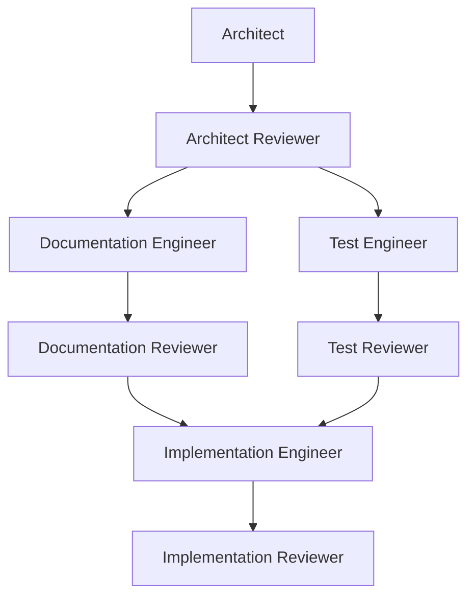

# DirectKG agent workflow

These are independent initial prompts for separate AI conversations. The project owner selects assignments, accepts design decisions and relays review handoffs. Each role retrieves repository files directly from GitHub; handoffs supply decisions, scope, revisions and review findings, not manually uploaded repository files.

## Active prompts

| Role | Prompt |
| --- | --- |
| Adviser | [adviser/adviser.md](adviser/adviser.md) |
| Architect | [architect/architect.md](architect/architect.md) |
| Architect Reviewer | [architect/architect-reviewer.md](architect/architect-reviewer.md) |
| Documentation Engineer | [documentation/documentation-engineer.md](documentation/documentation-engineer.md) |
| Documentation Reviewer | [documentation/documentation-reviewer.md](documentation/documentation-reviewer.md) |
| Test Engineer | [test/test-engineer.md](test/test-engineer.md) |
| Test Reviewer | [test/test-reviewer.md](test/test-reviewer.md) |
| Implementation Engineer | [implementation/implementation-engineer.md](implementation/implementation-engineer.md) |
| Implementation Reviewer | [implementation/implementation-reviewer.md](implementation/implementation-reviewer.md) |

## Execution and acceptance

Each reviewer edge requires an applicable OK for the exact decision, scope and revision/disposition. Documentation and testing may run in parallel after Architect Reviewer OK; implementation requires both reviewed outcomes. An engineer's justified no-change result also requires its reviewer OK, without an artificial edit or empty commit. BLOCKED does not close a gate.

The Adviser operates independently. The Architect combines design investigation, owner-approved specification registration and open-issue maintenance; there is no active Documenter role or separate session-consolidation workflow. Reviewers verify independently and never silently correct files or create design authority.

The owner accepts substantive design before registration; reviewer acceptance verifies the recorded result. A published commit alone is not a review verdict. Tests accepted by their reviewer can still fail against incomplete production; implementation uses their actual expectations and failures while the accepted specification remains normative.

## Repository context and ownership

Discover current non-archived documents in [documentation/specification/](../specification/), checking titles, authority and current history rather than sorting historical filenames. Current entry points are [transformation-specification.md](../specification/transformation-specification.md), [open-design-issues.md](../specification/open-design-issues.md), [documentation-structure.md](../specification/documentation-structure.md), and [test-suite-structure.md](../specification/test-suite-structure.md).

The Architect owns accepted specification/open-issue registration. Documentation, test and implementation engineers own their respective artifacts; each has a separate reviewer. The specification governs behavior, structure documents govern placement, tests provide executable evidence and code establishes observed functionality. Historical documents, examples and unresolved alternatives cannot create requirements.

Writers normally publish their authorized future work to main using non-force updates and concurrency checks, then submit for independent review. Explicit task-specific branch restrictions override that default. Reviewer roles are read-only. These prompts do not authorize an agent to start another role or send its handoff itself.

Handoffs identify exact approved scope, source and submitted/snapshot SHAs, changed paths or no-change evidence, requirement-to-artifact coverage, checks/results/limitations and prior findings for corrections. Refer to each role's full protocol. No additional persistent approval ledger is required.

## Active and archived versions

Active filenames are descriptive and unversioned. Each role directory has an archive/ subdirectory. Superseded prompts use <document-name>-YYYYMMDDTHHMMSSZ.md: UTC to seconds from the outgoing revision's last content-changing commit, following pure moves/renames with unchanged content. This matches the established specification archive convention. Do not use the migration time as an invented historical modification time.

Preserve exact predecessor bytes and mode, preferably by reusing its Git blob. Check destination availability; never overwrite different historical content. A verified identical existing predecessor can be reused. Publish preservation and replacement together in an atomic commit. Apply the same procedure to future prompt replacements; Architect document updates use documentation/specification/archive/ independently for each modified active document.

Archived prompts are historical evidence, not instructions for current agents. The six former Architect/Documenter prompts are retained under architect/archive/ with descriptive identities; their relevant responsibilities are consolidated in architect.md. Existing historical repository citations remain tied to their original commits.

## Migration provenance

The table identifies each preserved predecessor, its new active destination, archive and last content-changing commit. All paths below are relative to this directory.

| Former file | Active destination | Preserved archive | Timestamp source commit |
| --- | --- | --- | --- |
| adviser-01-initialize-and-operate.md | [adviser/adviser.md](adviser/adviser.md) | [adviser/archive/adviser-20261021T094115Z.md](adviser/archive/adviser-20261021T094115Z.md) | [7870042](https://github.com/pedropaulofb/ontouml-directkg/commit/7870042a02e094dca772d6fdd6570ad7b2d02578) |
| architect-01-prerequisite-study.md | [architect/architect.md](architect/architect.md) | [architect/archive/architect-prerequisite-study-20260913T212701Z.md](architect/archive/architect-prerequisite-study-20260913T212701Z.md) | [96d84e6](https://github.com/pedropaulofb/ontouml-directkg/commit/96d84e6dbbc8d1045290a2291e4d12730d08ab59) |
| architect-02-load-project-state.md | [architect/architect.md](architect/architect.md) | [architect/archive/architect-project-state-20261021T094115Z.md](architect/archive/architect-project-state-20261021T094115Z.md) | [7870042](https://github.com/pedropaulofb/ontouml-directkg/commit/7870042a02e094dca772d6fdd6570ad7b2d02578) |
| architect-03-operating-protocol.md | [architect/architect.md](architect/architect.md) | [architect/archive/architect-operating-protocol-20260913T212701Z.md](architect/archive/architect-operating-protocol-20260913T212701Z.md) | [96d84e6](https://github.com/pedropaulofb/ontouml-directkg/commit/96d84e6dbbc8d1045290a2291e4d12730d08ab59) |
| architect-99-session-open-issues-handoff.md | [architect/architect.md](architect/architect.md) | [architect/archive/architect-open-issues-handoff-20261030T091510Z.md](architect/archive/architect-open-issues-handoff-20261030T091510Z.md) | [8e34ef7](https://github.com/pedropaulofb/ontouml-directkg/commit/8e34ef70ff341faebaf2f7b3ca53f456aff21296) |
| documenter-01-initialize-and-operate.md | [architect/architect.md](architect/architect.md) | [architect/archive/documenter-20260913T212701Z.md](architect/archive/documenter-20260913T212701Z.md) | [96d84e6](https://github.com/pedropaulofb/ontouml-directkg/commit/96d84e6dbbc8d1045290a2291e4d12730d08ab59) |
| documenter-99-session-consolidated-specification.md | [architect/architect.md](architect/architect.md) | [architect/archive/documenter-consolidated-specification-20261030T091510Z.md](architect/archive/documenter-consolidated-specification-20261030T091510Z.md) | [8e34ef7](https://github.com/pedropaulofb/ontouml-directkg/commit/8e34ef70ff341faebaf2f7b3ca53f456aff21296) |
| documentation-engineer-01-initialize-and-operate.md | [documentation/documentation-engineer.md](documentation/documentation-engineer.md) | [documentation/archive/documentation-engineer-20261030T091510Z.md](documentation/archive/documentation-engineer-20261030T091510Z.md) | [8e34ef7](https://github.com/pedropaulofb/ontouml-directkg/commit/8e34ef70ff341faebaf2f7b3ca53f456aff21296) |
| documentation-reviewer-01-initialize-and-operate.md | [documentation/documentation-reviewer.md](documentation/documentation-reviewer.md) | [documentation/archive/documentation-reviewer-20261030T091510Z.md](documentation/archive/documentation-reviewer-20261030T091510Z.md) | [8e34ef7](https://github.com/pedropaulofb/ontouml-directkg/commit/8e34ef70ff341faebaf2f7b3ca53f456aff21296) |
| test-engineer-01-initialize-and-operate.md | [test/test-engineer.md](test/test-engineer.md) | [test/archive/test-engineer-20261030T091510Z.md](test/archive/test-engineer-20261030T091510Z.md) | [8e34ef7](https://github.com/pedropaulofb/ontouml-directkg/commit/8e34ef70ff341faebaf2f7b3ca53f456aff21296) |
| test-reviewer-01-initialize-and-operate.md | [test/test-reviewer.md](test/test-reviewer.md) | [test/archive/test-reviewer-20261030T091510Z.md](test/archive/test-reviewer-20261030T091510Z.md) | [8e34ef7](https://github.com/pedropaulofb/ontouml-directkg/commit/8e34ef70ff341faebaf2f7b3ca53f456aff21296) |
| implementation-engineer-01-initialize-and-operate.md | [implementation/implementation-engineer.md](implementation/implementation-engineer.md) | [implementation/archive/implementation-engineer-20261025T145803Z.md](implementation/archive/implementation-engineer-20261025T145803Z.md) | [c7d3132](https://github.com/pedropaulofb/ontouml-directkg/commit/c7d31322a29b6235bb599d4894e2bf24ab5dabf7) |
| implementation-reviewer-01-initialize-and-operate.md | [implementation/implementation-reviewer.md](implementation/implementation-reviewer.md) | [implementation/archive/implementation-reviewer-20261030T091510Z.md](implementation/archive/implementation-reviewer-20261030T091510Z.md) | [8e34ef7](https://github.com/pedropaulofb/ontouml-directkg/commit/8e34ef70ff341faebaf2f7b3ca53f456aff21296) |

The Architect Reviewer is new and has no superseded predecessor. There were no pre-existing prompt archive files in the migration base. Pure relocation commits were skipped when deriving historical timestamps; unchanged source blobs are reused in the archives.
