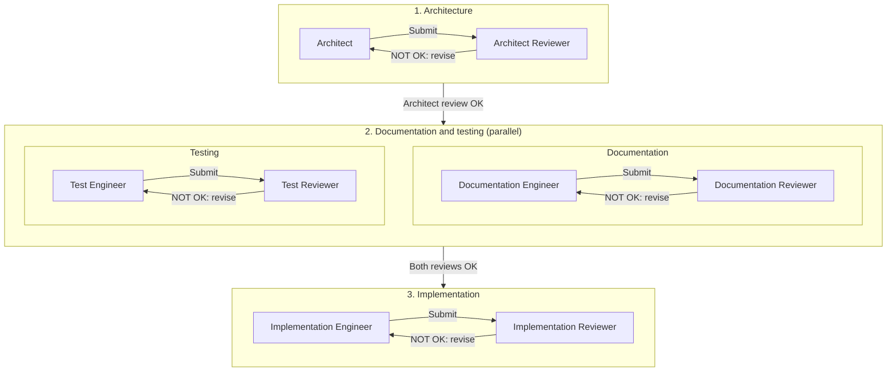

# DirectKG agent workflow

These are independent initial prompts for separate AI conversations. The project owner selects assignments, accepts design decisions and relays review handoffs. Each role retrieves repository files directly from GitHub; handoffs supply decisions, scope, revisions and review findings, not manually uploaded repository files.

## Active prompts

| Role | Prompt |
| --- | --- |
| Adviser | [adviser/adviser.md](adviser/adviser.md) |
| Architect | [architect/architect.md](architect/architect.md) |
| Architect Reviewer | [architect/architect-reviewer.md](architect/architect-reviewer.md) |
| Documentation Engineer | [documentation/documentation-engineer.md](documentation/documentation-engineer.md) |
| Documentation Reviewer | [documentation/documentation-reviewer.md](documentation/documentation-reviewer.md) |
| Test Engineer | [test/test-engineer.md](test/test-engineer.md) |
| Test Reviewer | [test/test-reviewer.md](test/test-reviewer.md) |
| Implementation Engineer | [implementation/implementation-engineer.md](implementation/implementation-engineer.md) |
| Implementation Reviewer | [implementation/implementation-reviewer.md](implementation/implementation-reviewer.md) |

## Periodic auditors

These four independent roles run only when manually invoked. Each audits the complete current state of its area and relevant cross-artifact relationships across development iterations, independently of earlier agent reports. Invocation starts the audit; no creator handoff, upstream reviewer OK or other active agent is required.

| Role | Prompt |
| --- | --- |
| Architecture Auditor | [architect/architect-auditor.md](architect/architect-auditor.md) |
| Implementation Auditor | [implementation/implementation-auditor.md](implementation/implementation-auditor.md) |
| Test Auditor | [test/test-auditor.md](test/test-auditor.md) |
| Documentation Auditor | [documentation/documentation-auditor.md](documentation/documentation-auditor.md) |

Auditors retrieve the requested branch/ref (default main), identify its full SHA, inspect actual repository evidence and report coverage and limitations. They remain read-only, distinguish confirmed defects, investigation needs and architectural/owner decisions, and route findings to the responsible existing role through the owner.

Audits are outside the execution and acceptance pipeline below. They do not issue workflow OK/NOT OK verdicts, close or waive gates, accept new semantics, launch other agents or authorize repairs. Prior review does not prevent a substantiated audit finding. The owner selects follow-up; corrections retain normal ownership and review requirements. No additional persistent audit ledger or approval stage is required.

## Execution and acceptance

Forward stage transitions require the applicable reviewer OK for the exact decision, scope and revision/disposition. NOT OK returns the submission to its producing role for correction and re-review. Documentation and testing may run in parallel after Architect Reviewer OK; implementation requires both reviewed outcomes. An engineer's justified no-change result also requires its reviewer OK, without an artificial edit or empty commit. BLOCKED does not close a gate. An ordinary assignment does not waive upstream reviews. Any different sequence needs an explicit task-specific owner instruction, carried in the handoff and checked by the reviewer; all unaffected gates remain required.

The Adviser operates independently. The Architect investigates design decisions and registers owner-approved changes in the specification and open issues. Reviewers verify independently and never silently correct files or create design authority.

The owner accepts substantive design before registration; reviewer acceptance verifies the recorded result. A published commit alone is not a review verdict. Tests accepted by their reviewer can still fail against incomplete production; implementation uses their actual expectations and failures while the accepted specification remains normative.

## Repository context and ownership

Discover current non-archived documents in [documentation/specification/](../specification/), checking titles, authority and current history rather than sorting historical filenames. Current entry points are [transformation-specification.md](../specification/transformation-specification.md), [open-design-issues.md](../specification/open-design-issues.md), [documentation-structure.md](../specification/documentation-structure.md), and [test-suite-structure.md](../specification/test-suite-structure.md).

The Architect owns accepted specification/open-issue registration. Documentation, test and implementation engineers own their respective artifacts; each has a separate reviewer. The specification governs behavior, structure documents govern placement, tests provide executable evidence and code establishes observed functionality. Historical documents, examples and unresolved alternatives cannot create requirements.

Writers normally publish their authorized future work to main using non-force updates and concurrency checks, then submit for independent review. Explicit task-specific branch restrictions override that default. Reviewer roles are read-only. These prompts do not authorize an agent to start another role or send its handoff itself.

Handoffs identify exact approved scope, source and submitted/snapshot SHAs, changed paths or no-change evidence, requirement-to-artifact coverage, checks/results/limitations and prior findings for corrections. Refer to each role's full protocol. No additional persistent approval ledger is required.

## Active and archived versions

Each role directory contains its current, unversioned prompts and an `archive/` subdirectory for superseded versions. Archived prompts provide historical context and do not govern current agents.

Archive filenames follow `<document-name>-YYYYMMDDTHHMMSSZ.md`: UTC to seconds from the outgoing revision's last content-changing commit, following pure moves or renames with unchanged content. This matches the specification archive convention.

When replacing a prompt, preserve its exact predecessor bytes and file mode, preferably by reusing the Git blob. Never overwrite different historical content; a verified identical archive can be reused. Publish preservation and replacement together in an atomic commit. The Architect applies the corresponding procedure separately to each modified authoritative document in `documentation/specification/archive/`.
