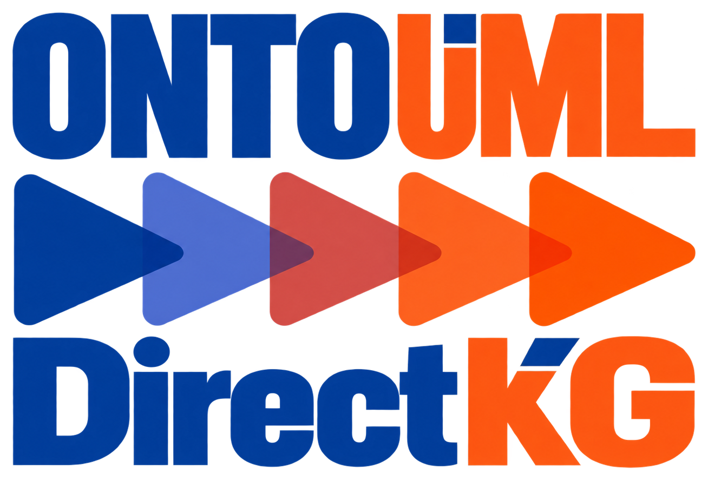

# Home

OntoUML DirectKG transforms supported OntoUML models into a domain-oriented RDF/OWL graph. Its classes and properties represent the modeled domain, rather than the OntoUML metamodel, Visual Paradigm diagrams, or the JSON document structure.

## Current availability

**These pages describe accepted intended behavior.** At the reviewed repository revision, `9e52a66af43e39b374d0a642298b1117d12be4d8`, no production conversion library, CLI, or supported installation mechanism exists. Python test material is present; that does not establish a working converter. Runnable installation, conversion, and Python API guidance is pending implementation and verification.

The website provides shared contracts, conceptual guidance, mappings, and contract-based [CLI](guides/cli.md), [Python](guides/python.md), and [Metadata and provenance](guides/metadata-and-provenance.md) guides. [Examples](examples/index.md) supplies a checked Catalog adaptation paired with an illustrative Turtle excerpt. [Contributing](development/contributing.md) explains documentation maintenance and available development checks. Getting started and generated API pages remain pending their implementation prerequisites.

## Scope at a glance

| Question | Accepted boundary |
| --- | --- |
| What input is supported? | VP-plugin 0.5.3-style OntoUML JSON, with the explicitly bounded language enrichment. Other exporter versions may work, but compatibility is not guaranteed. |
| What is generated? | Domain-oriented RDF/OWL; RDF 1.1 Turtle is the sole officially supported ontology serialization. |
| Which interfaces are required? | A Python library and a CLI with semantically equivalent transformation controls. |
| Does conversion validate OntoUML semantics? | No. Structural processability is required, while semantic mistakes and possible ontology inconsistency are not repaired. |
| Is information preserved without loss? | No. Some constructs have partial mappings, comment-only preservation, or intentional omission. |
| Is an OWL profile guaranteed? | No general OWL profile guarantee is established. |

## Find the relevant contract

- Start with [Semantics and limitations](concepts/semantics.md) to interpret the graph and its preservation boundaries.
- Read the [Input contract](reference/input.md) before preparing an export.
- Read the [Output contract](reference/output.md) to understand ontology identity, artifact formats, and graph-versus-text guarantees.
- Use [Controls](reference/controls.md) for the accepted option values, defaults, and interface boundaries. Read [Diagnostics and recovery](reference/diagnostics.md) for policies, outcomes, complete diagnostic access, and multiplicity recovery.
- Follow [Classes and enumerations](mapping/classes.md), [Higher-order classification](mapping/higher-order.md), and [Attributes and datatypes](mapping/attributes-and-datatypes.md) to interpret classifier and value mappings.
- Follow [Binary relations](mapping/relations.md), [Inverse properties](mapping/inverses.md), and [Property features](mapping/property-features.md) for relation direction, constraints, and partial property mappings.
- Read [Derivations and material chains](mapping/derivations-and-chains.md), [Mereology and DKGM](mapping/mereology.md), and [Instantiation associations](mapping/instantiation.md) for their distinct preservation and reasoning boundaries.
- Use [Identifiers and naming](reference/identifiers.md) and [Labels, comments, and language](reference/text.md) for generated identity and human-readable text; see [Persistent identifiers and redirects](reference/persistent-identifiers.md) for the registered project and vocabulary URLs.
- Inspect [Examples](examples/index.md) for the paired source data and mapping excerpt; use [Contributing](development/contributing.md) for build, preview, and maintenance instructions.

## Relationship to other approaches

DirectKG aims for a comparatively lightweight graph of domain concepts and relations. It does not adopt gUFO imports or its UFO-based representation merely because gUFO is a related approach. It also avoids reproducing the source JSON's serialization machinery. Simplification follows the accepted mapping rules without introducing additional semantics or omitting information beyond those rules.

---

Governing source: §§2–3; baseline consolidated: **2026-10-21**; repository commit: `9e52a66af43e39b374d0a642298b1117d12be4d8`; source: [`documentation/specification/2026-10-21 - specification handoff.md`](https://github.com/pedropaulofb/ontouml-directkg/blob/9e52a66af43e39b374d0a642298b1117d12be4d8/documentation/specification/2026-10-21%20-%20specification%20handoff.md).

## License

The repository includes the [Apache License 2.0](https://github.com/pedropaulofb/ontouml-directkg/blob/main/LICENSE). The [mereology vocabulary](https://github.com/pedropaulofb/ontouml-directkg/blob/main/vocabulary/latest/dkgm-vocabulary.ttl) separately declares **CC BY 4.0** in its RDF metadata.

## Authorship and independence

OntoUML DirectKG was independently conceived and developed by **[Pedro Paulo Favato Barcelos](https://w3id.org/pedropaulofb)**, its sole creator, author, and developer. Profiles: [GitHub](https://github.com/pedropaulofb), [ORCID](https://orcid.org/0000-0003-2736-7817), and [LinkedIn](https://www.linkedin.com/in/pedro-paulo-favato-barcelos/).

The project is a personal contribution to the OntoUML community and its broader ecosystem. It is **not an official OntoUML project, tool, or implementation**, and it is not endorsed by the OntoUML maintainers.
